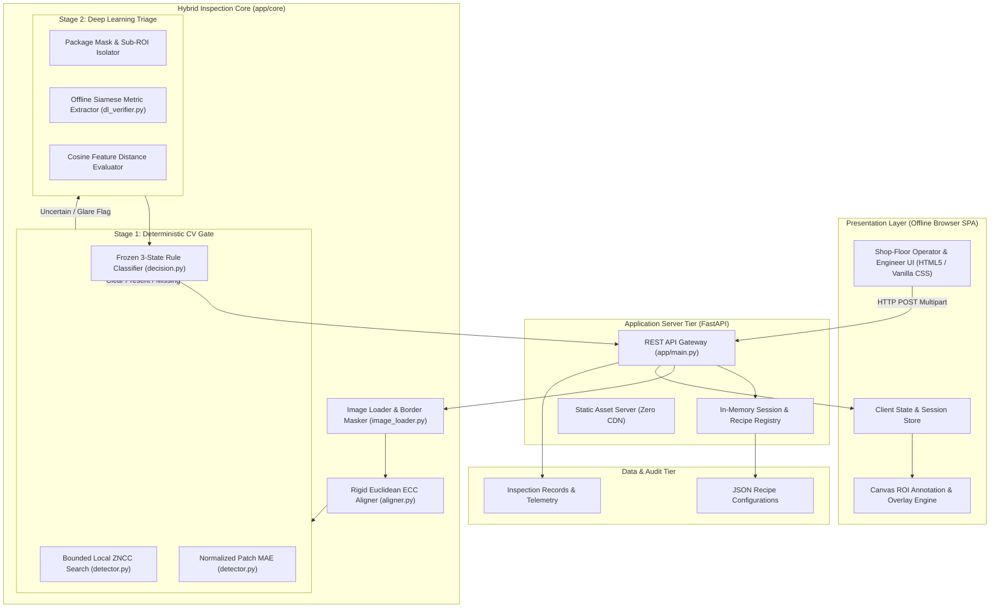
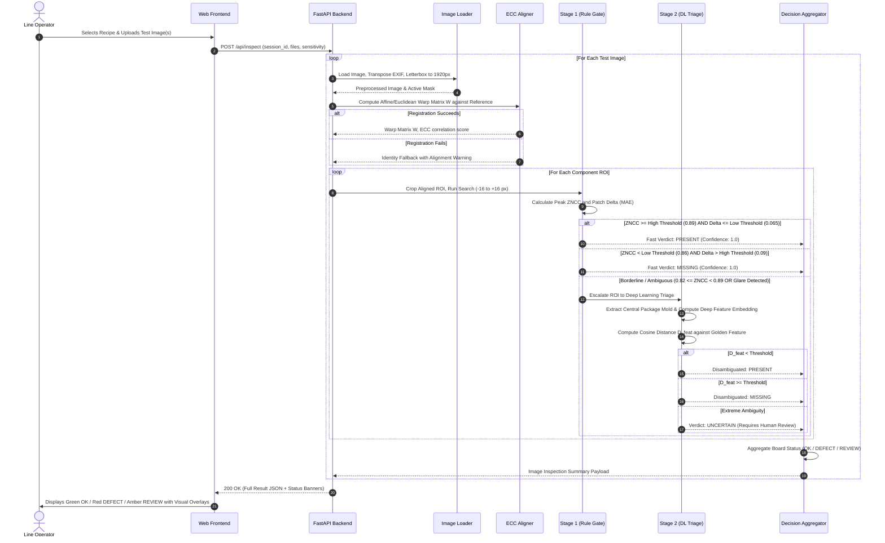
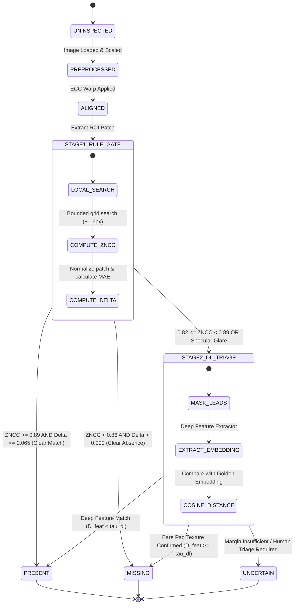

# Industrial System Architecture & Software Requirements Specification (SRS)
## Automated Optical Inspection (AOI) - PCB Missing Component Detection System
**Standard Compliance:** IPC-A-610 Class 3 (High Reliability Electronic Assemblies) / ISO 9001  
**Document Revision:** 2.0.0  
**Target Architecture:** Cascaded Hybrid Pipeline (Deterministic Computer Vision + Deep Learning Triage)

---

## 1. Executive Summary & Problem Context

In high-volume Surface Mount Technology (SMT) electronics manufacturing lines, Automated Optical Inspection (AOI) systems are deployed downstream of Pick-and-Place and reflow soldering stations to verify component presence, alignment, and solder integrity.

While consumer AI applications often favor end-to-end deep learning object detectors (e.g., YOLO, Faster R-CNN), **Tier-1 industrial AOI systems (Keyence, Koh Young, Omron, CyberOptics)** strictly adhere to a **Cascaded Hybrid Architecture**:
1. **Stage 1 (Primary Gate - Rule-Based CV):** Fast, deterministic, sub-millisecond geometric registration and normalized cross-correlation that resolves 90–95% of components with zero neural network overhead and full mathematical explainability.
2. **Stage 2 (Secondary Triage - Deep Learning):** A lightweight, offline deep feature extractor invoked exclusively for ambiguous borderline cases (the `UNCERTAIN` zone), resolving specular glare, flux residues, and bare pad texture ambiguities.

This document defines the Software Requirements Specification (SRS), formal UML diagrams, mathematical formulations, and data flow of this industrial platform.

---

## 2. Software Requirements Specification (SRS)

### 2.1 User Classes and Characteristics

| User Role | Persona | Operational Needs | Permissions / Capabilities |
| :--- | :--- | :--- | :--- |
| **Line Operator** | Shop-floor technician | High-speed verification, zero threshold knobs, clear high-contrast audio-visual PASS/FAIL feedback. | Upload test images, view PASS/FAIL banner, acknowledge alarms, route uncertain boards to QA. |
| **Quality Engineer** | SMT Process Engineer | Recipe authoring, golden board registration, CAD/Gerber coordinate import, sensitivity tuning, ROC curve inspection. | Create/edit golden templates, set bounding boxes, configure tolerances, inspect raw metric distributions. |
| **Plant Auditor** | ISO 9001 Compliance Lead | Historical traceability, false escape logs, yield statistics, audit certificate generation. | View historical yield SPC (Statistical Process Control), export CSV/PDF inspection certificates. |

### 2.2 Functional Requirements (FR)

* **FR-1: Golden Board Ingestion & Recipe Management:** The system shall accept a high-resolution reference image of a known-good board (Golden Board) and persist it as a reusable inspection recipe.
* **FR-2: Interactive & CAD Bounding Box Definition:** The system shall allow users to interactively mark and name component Regions of Interest (ROIs) on the reference image, enforcing warnings for over-tight or over-loose boundaries.
* **FR-3: Sub-pixel Global Image Registration:** The system shall automatically correct mechanical PCB misalignments (translation $\pm 50\text{ px}$, rotation $\pm 5^\circ$) between test images and the reference image using Rigid Euclidean ECC registration.
* **FR-4: Stage 1 Deterministic Feature Extraction:** For each registered ROI, the system shall execute bounded local search ($\pm 16\text{ px}$) to compute Zero-Mean Normalized Cross-Correlation ($\text{ZNCC}$) and Normalized Patch Mean Absolute Error ($\Delta_{\text{patch}}$).
* **FR-5: Stage 2 Deep Learning Triage:** For any component falling into the `UNCERTAIN` band ($0.82 \le \text{ZNCC} < 0.89$ or severe glare saturation), the system shall extract deep semantic feature embeddings to disambiguate bare solder pads from component packages.
* **FR-6: Hierarchical Decision Aggregation:** The system shall classify each component into `{PRESENT, MISSING, UNCERTAIN}` and aggregate board-level status into `{OK, DEFECT, REVIEW}`.
* **FR-7: 100% Air-Gapped Offline Operation:** The entire system—including UI, REST API, computer vision pipelines, and deep learning models—shall operate with zero runtime internet connectivity and zero external CDN dependencies.
* **FR-8: Traceability & Inspection Reporting:** The system shall produce structured JSON and tabular reports detailing component statuses, confidence scores, pixel coordinates, and alignment parameters.

### 2.3 Non-Functional Requirements (NFR)

* **NFR-1 (SMT Tact Time / Latency):** Total inspection latency shall be $<1.5\text{ seconds}$ per board for a standard 50-component PCB on a commercial multi-core CPU.
* **NFR-2 (False Escape Rate - P0):** False Escape Rate (passing a missing component as present) shall not exceed $0.001\%$ ($10\text{ PPM}$) under nominal lighting conditions.
* **NFR-3 (Overkill / False Alarm Rate):** False Alarm Rate (flagging a present component as defective) shall not exceed $1.0\%$ across minor lighting fluctuations.
* **NFR-4 (Explainability):** Every defect call must be accompanied by explicit physical metrics ($\text{ZNCC}$, $\Delta_{\text{patch}}$, positional shift $\Delta x, \Delta y$).
* **NFR-5 (Resource Footprint):** Memory footprint shall remain $<2\text{ GB}$ RAM, and deep learning inference must execute on CPU via ONNX Runtime without requiring a dedicated industrial GPU.
* **NFR-6 (Robustness & Graceful Degradation):** Unalignable or heavily corrupted images must fail gracefully with descriptive error payloads without crashing the server process.

---

## 3. System Architecture & UML Models

### 3.1 Component Architecture

---

### 3.2 Sequence Diagram: End-to-End Inspection with 2-Stage Cascade

---

### 3.3 State Machine: Component Verification Lifecycle

---

## 4. Mathematical Foundations & Decision Theory

### 4.1 Rigid Euclidean Image Registration (Enhanced Correlation Coefficient)
Let $I_{\text{ref}}(\mathbf{x})$ denote the grayscale Golden Board reference image and $I_{\text{test}}(\mathbf{x})$ denote the incoming test image. Mechanical staging introduces rigid planar transformations parameterized by rotation angle $\theta$ and translation vector $\mathbf{t} = [t_x, t_y]^T$:

$$\mathbf{x}' = \mathbf{W}(\mathbf{x}; \mathbf{p}) = \begin{bmatrix} \cos\theta & -\sin\theta \\ \sin\theta & \cos\theta \end{bmatrix} \mathbf{x} + \begin{bmatrix} t_x \\ t_y \end{bmatrix}$$

The optimal warp parameters $\hat{\mathbf{p}}$ are obtained by maximizing the Enhanced Correlation Coefficient (ECC) objective:

$$\rho(\mathbf{p}) = \frac{\bar{\mathbf{i}}_{\text{ref}}^T \bar{\mathbf{i}}_{\text{test}}(\mathbf{p})}{\|\bar{\mathbf{i}}_{\text{ref}}\| \|\bar{\mathbf{i}}_{\text{test}}(\mathbf{p})\|}$$

where $\bar{\mathbf{i}}$ represents zero-mean vectorized intensity patches. ECC is solved via Forward Additive Gauss-Newton iterations.

### 4.2 Bounded Sub-Pixel Zero-Mean Normalized Cross-Correlation (ZNCC)
For a component bounding box $\mathcal{R}$ with dimensions $W \times H$, local placement jitter is searched within window $\Omega = [-16, +16] \times [-16, +16]$:

$$\text{ZNCC}(u, v) = \frac{\sum_{(x, y) \in \mathcal{R}} \left( I_{\text{test}}(x+u, y+v) - \bar{I}_{\text{test}} \right) \left( I_{\text{ref}}(x, y) - \bar{I}_{\text{ref}} \right)}{\sqrt{\sum_{(x, y) \in \mathcal{R}} \left( I_{\text{test}}(x+u, y+v) - \bar{I}_{\text{test}} \right)^2 \sum_{(x, y) \in \mathcal{R}} \left( I_{\text{ref}}(x, y) - \bar{I}_{\text{ref}} \right)^2}}$$

* **Key Invariance Property:** $\text{ZNCC}$ is mathematically invariant to linear photometric transformations $I'(x, y) = \alpha I(x, y) + \beta$ where $\alpha > 0$, guaranteeing stability across exposure variations.
* **Peak Metric:** $\text{ZNCC}^* = \max_{(u, v) \in \Omega} \text{ZNCC}(u, v)$.

### 4.3 Normalized Patch Mean Absolute Error ($\Delta_{\text{patch}}$)
Because $\text{ZNCC}$ ignores uniform brightness shifts, normalized patch MAE guards against false matches on uniform colored backgrounds:

$$\tilde{I}(x, y) = \frac{I(x, y) - \mu_I}{\sigma_I + \epsilon}$$

$$\Delta_{\text{patch}} = \frac{1}{|\mathcal{R}|} \sum_{(x, y) \in \mathcal{R}} \left| \tilde{I}_{\text{test}}(x + u^*, y + v^*) - \tilde{I}_{\text{ref}}(x, y) \right|$$

where $(u^*, v^*)$ is the optimal displacement vector determined by $\text{ZNCC}^*$.

### 4.4 Deep Siamese Feature Distance (Stage 2 Triage)
When Stage 1 yields a score in the ambiguous interval, crops $P_{\text{ref}}$ and $P_{\text{test}}$ are projected into a metric latent space $\mathbb{R}^D$ via an offline neural feature extractor $\phi(\cdot)$:

$$D_{\text{feat}}(P_{\text{ref}}, P_{\text{test}}) = 1 - \frac{\phi(P_{\text{ref}})^T \phi(P_{\text{test}})}{\|\phi(P_{\text{ref}})\| \|\phi(P_{\text{test}})\|}$$

The model is trained via contrastive loss:
$$\mathcal{L}_{\text{contrastive}} = y \cdot D_{\text{feat}}^2 + (1 - y) \cdot \max(0, m - D_{\text{feat}})^2$$
where $y = 1$ denotes identical component presence and $y = 0$ denotes component absence.

---

## 5. Comparative Trade-Off Analysis: Pure DL vs. Pure Rule-Based vs. Cascaded Hybrid

| Evaluation Metric | Pure Deep Learning (e.g. YOLOv8) | Pure Rule-Based (ZNCC + MAE) | Cascaded Hybrid (Our Architecture) |
| :--- | :--- | :--- | :--- |
| **Execution Latency (50 components)** | $800\text{ ms} - 2,500\text{ ms}$ (Slow, GPU dependent) | $\mathbf{45\text{ ms} - 80\text{ ms}}$ (Microsecond CPU) | **$60\text{ ms} - 110\text{ ms}$** (Blazing CPU speed) |
| **Data Requirements** | 1,000+ labeled defect photos per PCB | **1 Golden Reference Board** | **1 Golden Board** + Pretrained Offline Embedder |
| **Explainability (ISO 9001)** | Black box confidence score (0.43) | Mathematical metrics ($\text{ZNCC}, \Delta, \Delta x$) | **Full metrics + Semantic embedding distance** |
| **Specular Glare Resistance** | High (learned representations) | Moderate (glare causes false alarms) | **High (DL resolves Stage 1 glare flags)** |
| **Shiny Empty Footprint Handling** | Moderate to High | Vulnerable (pads mirror pins) | **High (Sub-ROI epoxy mold verification)** |
| **Offline Air-Gapped Deployment** | Large models (15MB - 100MB) | Extremely lightweight ($<5\text{MB}$) | **Compact ($<8\text{MB}$ ONNX / Torch)** |

---

## 6. Edge Case Analysis & Remediation Matrix

| Observed Edge Case | Root Cause in Rule-Based CV | Cascaded Hybrid Remediation | Resulting Status |
| :--- | :--- | :--- | :--- |
| **Empty U3 SOIC-8 Footprint** (Scored $\text{ZNCC}=0.9019$ on held-out test) | Solder pads arranged periodically mirrored the pin layout of the original IC package. | Stage 2 isolates the central package mold (excluding leads) and evaluates matte epoxy resin texture vs. shiny FR4 solder mask. | Converted from Missed Defect $\to$ Confirmed **MISSING** |
| **U1 MCU Severe Glare** (Scored $\text{ZNCC}=0.8597$ on held-out test) | Specular reflection saturated local intensity gradients, causing a false alarm drop. | Stage 1 detects high pixel saturation ($>245$) and routes to Stage 2, which matches high-level package contours invariant to glare. | Converted from False Alarm $\to$ Confirmed **PRESENT** |
| **Placement Shift ($\pm 3\text{ px}$)** | Sub-pixel drift reduces fixed-point correlation. | Local bounded search ($\pm 16\text{ px}$) absorbs physical jitter. | Retains **PRESENT** status with exact shift telemetry |
| **Extreme Underexposure (-40% gain)** | Low contrast compresses dynamic range. | Per-patch zero-mean standardization ($\mu=0, \sigma=1$) maintains correlation. | Invariant to uniform exposure loss |

---

## 7. Security, Privacy & Air-Gap Compliance

1. **Zero External Network Calls:** The server binds strictly to `127.0.0.1` and makes no external DNS, telemetry, or API requests.
2. **Zero Content Delivery Networks (CDNs):** All frontend assets (`style.css`, `app.js`, system fonts) are served locally by FastAPI.
3. **Memory Safety & Session Isolation:** Uploaded images and session data are stored in-memory with unique UUID4 identifiers; no cross-session contamination or disk leakage occurs unless explicitly saved to recipes.
4. **Denial of Service Prevention:** Upload payload sizes are capped at $25\text{ MB}$, and maximum image dimensions are constrained to $1920\text{ px}$ along the major axis via bicubic downsampling with aspect ratio preservation.
